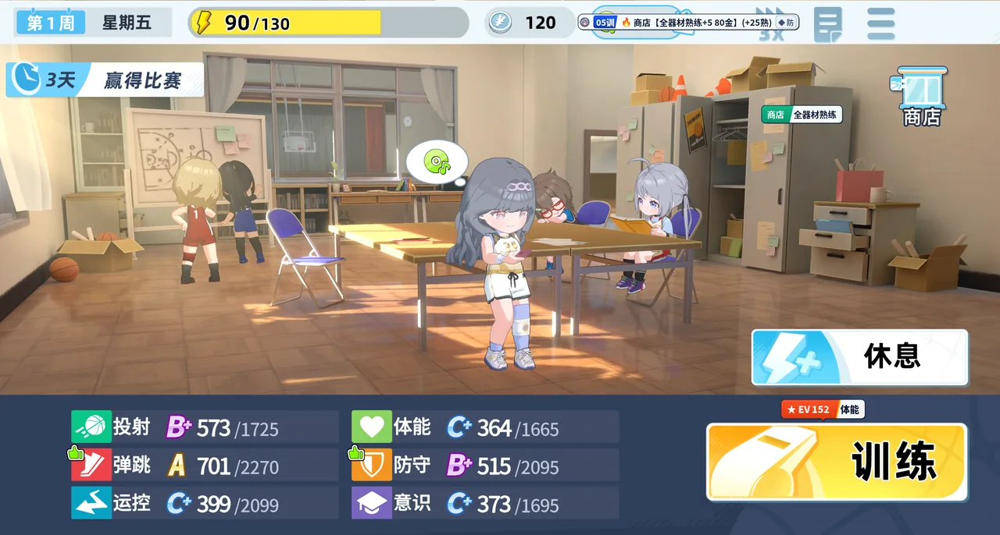
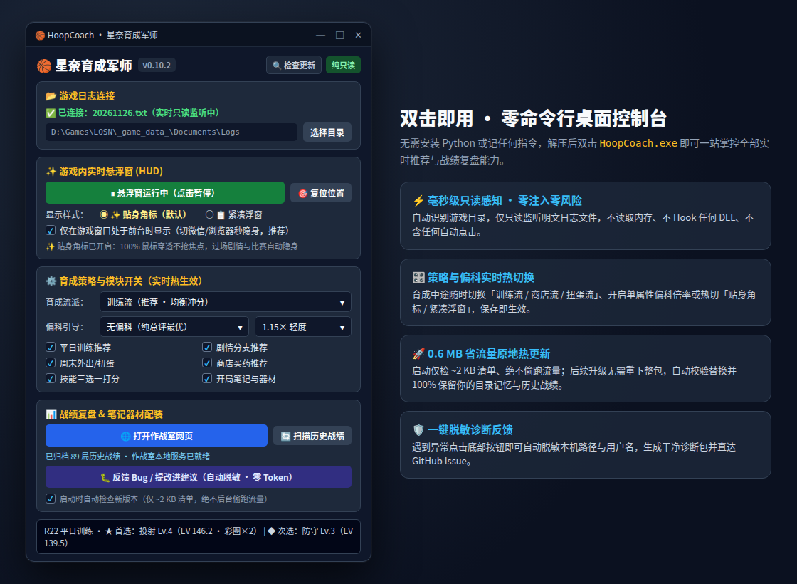
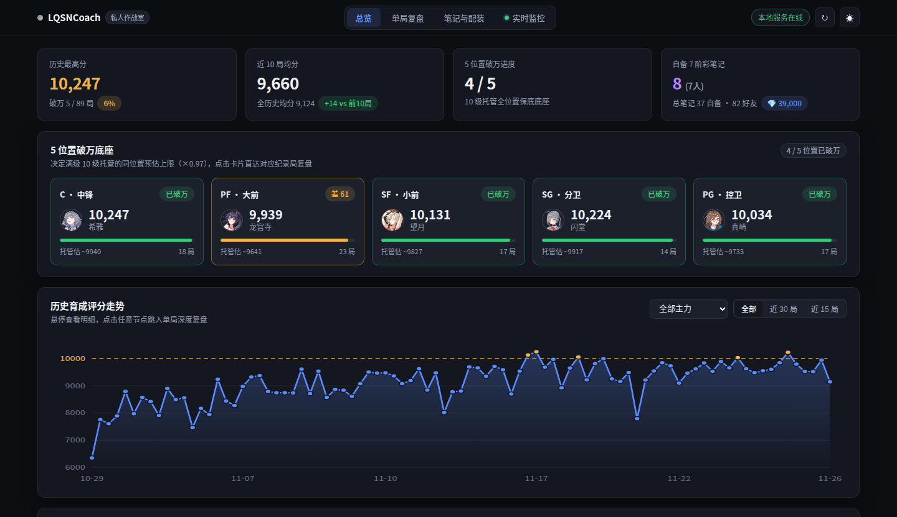
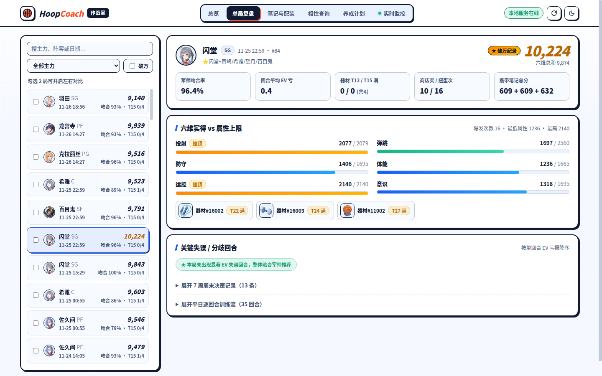

# HoopCoach

> 《篮球少女：飞跃巅峰》(*Hoop Girls*) 纯只读实时育成助手 · [**在线预览主页**](https://ejuneg.github.io/HoopCoach/)

[](https://ejuneg.github.io/HoopCoach/)
[](#safety)
[](#quickstart)
[](#quickstart)

只读监听游戏本地日志，在游戏画面旁实时给出**训练收益排序、周末/商店/扭蛋决策、剧情与选技能建议、开局笔记相性计算与器材配装**，并附带本地网页版战绩复盘。



<a id="safety"></a>

> **安全说明**：仅只读解析游戏明文日志（`Logs`），**不读/写内存、不 Hook、不改游戏文件、无任何自动点击或挂机功能**，等同于自动同步数据的本地攻略计算器。

---

<a id="quickstart"></a>

## 3 步快速上手（Windows 免装 Python）

1. 前往 [**Releases 最新版**](https://github.com/EjuneG/HoopCoach/releases/latest) 下载 `HoopCoach-Windows-*.zip`，**完整解压**到任意目录（勿在压缩包内直接双击）。
2. 双击 **`HoopCoach.exe`**，首次启动自动识别游戏目录；未识别时点 **「选择目录」** 选中游戏文件夹即可。
3. 正常打开游戏（建议**无边框窗口化**）开始育成，角标会自动贴在按钮旁。

- **省心更新**：客户端自带增量热更新，发现新版本后顶栏亮灯提示，确认后仅下载约 **0.6 MB** 补丁原地升级，不丢配置与历史战绩。
- **不挡视线**：角标 **100% 鼠标穿透**、不抢焦点；切到微信/浏览器、或进入过场剧情与比赛时自动隐藏。

---

## 核心功能

### 1. 游戏内贴身角标 & 紧凑浮窗
- **平日训练**：6 选 1 精确收益（EV）排序，标出彩圈、羁绊突破与体力/哨子控线预警。
- **全场景覆盖**：周末外出、商店买药、扭蛋、剧情分支、选技能三选一、开局选人笔记与器材配装实时提示。
- **自由切换**：支持在「贴身角标」与「紧凑浮窗」间一键切换，自动适配常见屏幕比例。

### 2. 免命令行桌面控制台
双击即用，可随时热切育成流派（训练流 / 商店流 / 扭蛋流）、指定单属性偏科、开关推荐项，或一键脱敏提交 Bug 反馈。



### 3. 本地网页作战室（战绩复盘）
在控制台点击 **「🌐 打开作战室网页」**，即可查看历史评分走势、全位置养成进度，以及单局 28 训逐回合复盘与亏损定位。





---

## 常见问题

- **Windows Defender 提示“已保护你的电脑”？**  
  个人开源打包未购置商业签名证书，点 **「更多信息」→「仍要运行」** 即可；也可直接拉源码运行或通过 GitHub Actions 自行构建。
- **进游戏后没看到悬浮角标？**  
  1. 先确认控制台顶部显示 **「✅ 已连接」**；
  2. 大厅、纯剧情、加载与比赛界面会自动隐藏，进入选人或训练页即显示；
  3. 游戏建议设为 **无边框窗口化 / 窗口化**（副屏使用可关闭「仅游戏前台显示」）。

---

<details>
<summary><b>开发者源码运行 / 本地构建（点击展开）</b></summary>

需要 Python 3.10+ 与 `tkinter`（安装 `pillow` 开启 Windows 贴身角标，未安装时自动回退紧凑浮窗）：

```bash
pip install pillow

# 启动桌面控制台 + 实时 HUD
python src/win_launcher.py

# 启动本地作战室网页
python src/dashboard_server.py --open
```

本地构建 Windows 绿色包：

```powershell
pip install pyinstaller pillow
pyinstaller --noconfirm --clean packaging/lqsncoach.spec
```

</details>
